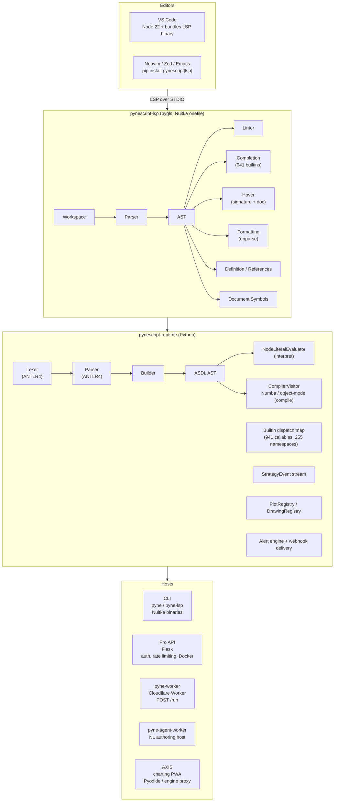
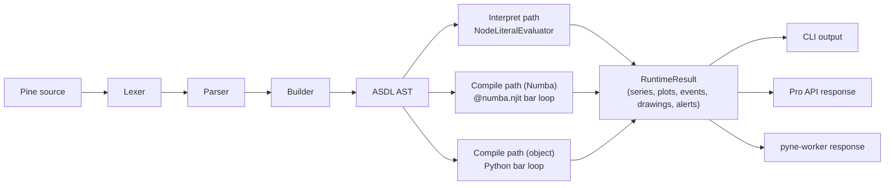

# Design

A high-level look at **how pynescript is put together and why**. For *what to
run* read [`AGENTS.md`](./AGENTS.md). For *deep reference* read
[`.opencode/context/`](./.opencode/context/navigation.md). For the LSP
implementation timeline read
[`.opencode/plans/pynescript-lsp-implementation.md`](./.opencode/plans/pynescript-lsp-implementation.md).

---

## 1. Mission

Give Pine Script™ developers a real, offline toolchain — parser, linter,
evaluator, completion, hover, navigation, and formatting — that works in any
LSP-capable editor (VS Code, Neovim, Zed, Emacs), without depending on
TradingView's browser-only editor.

Pine Script™ is a small DSL with ~482 builtins (941 callables on live dispatch
as of 2026-10-08). The toolchain goal is to model it fully enough that scripts
can be:

- **Parsed** losslessly (round-trip parse → unparse).
- **Statically analysed** (9+ lint rules, type system, UDT inference).
- **Evaluated** deterministically (literal expressions, full scripts with mock
  data).
- **Edited professionally** (LSP-driven diagnostics, completion, hover,
  formatting, definition, references, document symbols).

A Pro API layer adds live chart previews and backtests on top of the same
evaluation engine, monetizing the work the open toolchain drives.

---

## 2. System Architecture

---

## 3. Evaluation Pipeline

### Lexing and Parsing

The ANTLR4-generated lexer handles Pine source including multiline strings,
soft keywords, and bitwise operators. The parser produces an ASDL AST with
full structural fidelity — round-trip parse → unparse preserves the program.

### Building

The builder transforms the parse tree into the evaluator's node
representation. This stage resolves variable declarations, function
signatures, and type annotations.

### Evaluation

`NodeLiteralEvaluator` walks the AST in bar-loop mode. Each bar, it:

1. Updates series variables (OHLCV, derived prices, user state)
2. Executes the script body
3. Dispatches builtins through the registry
4. Records plot and drawing effects
5. Processes strategy orders and events

### Compilation

The compile path lowers the AST to Python/numpy source. Pure numeric scripts
are JIT-compiled via Numba. Scripts using UDTs, maps, or drawings use an
object-mode Python bar loop. Both paths produce identical series output for
eligible scripts.

---

## 4. Key Design Decisions

### Bar-Loop Semantics

Pine Script™ is a bar-loop language. Every script executes once per bar, with
series state carried forward. PYNE preserves this exactly — no whole-script
vectorization. Incremental TA kernels maintain call-site state and update one
sample per bar, achieving 3–10x speedups while preserving exact bar-loop
behavior.

### Honest NA

Foreign `request.security` data returns `na` on both interpret and compile
hosts. No chart-close is invented as foreign fundamentals. This is a core
design principle: honest `na` is better than silent invention.

### Interpret is the Oracle

The interpret path is the language oracle. Compile matches where eligible;
`mode=auto` falls back to interpret for unsupported constructs. This ensures
correctness is always available, even when compilation fails.

### Python Wins

Python is the language SoT. PyneTS (`@hoox-sh/pynets`) provides interpret and
JS compile modes but does not invent TradingView® behavior. Python remains
the oracle for all semantic decisions.

---

## 5. Data Flow

---

## 6. Testing Strategy

- **Unit tests** — Per-function tests for builtins, parser, evaluator
- **Golden tests** — TA kernels vs full recompute (incremental ≡ full)
- **Parity tests** — Interpret vs compile series comparison
- **Corpus tests** — Open-source script corpus (parse + runtime)
- **LSP tests** — Diagnostics, completion, hover, formatting
- **Integration tests** — Pro API endpoints, pyne-worker, CLI

---

## 7. Deployment

| Surface | Technology | Notes |
| --- | --- | --- |
| Package | `hoox-pyne` on PyPI | `pip install "hoox-pyne[lsp]"` |
| CLI | Nuitka binaries | `pyne` / `pyne-lsp` |
| Pro API | Flask + Docker | Auth, rate limiting, gevent worker |
| pyne-worker | Cloudflare Worker | Edge `POST /run` |
| pyne-agent-worker | Cloudflare Worker | NL authoring, Workers AI |
| AXIS | PWA + Pyodide | Charting, engine proxy |

---

*This document is maintained alongside the codebase. For the product-facing summary, see `docs/pyne/reference/ecosystem.mdx`.*
