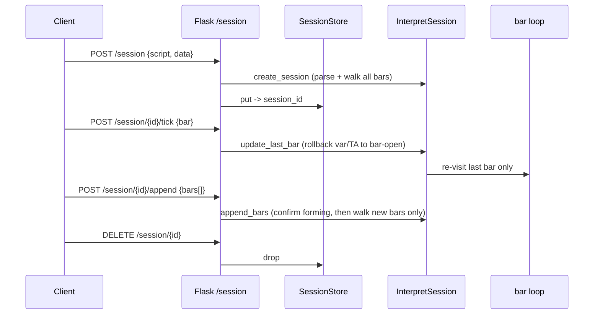

# Copyright (C) 2024-2026 jango_blockchained
#
# This file is part of pynescript.
#
# pynescript is free software: you can redistribute it and/or modify
# it under the terms of the GNU Affero General Public License as published by
# the Free Software Foundation, either version 3 of the License, or
# (at your option) any later version.
#
# pynescript is distributed in the hope that it will be useful,
# but WITHOUT ANY WARRANTY; without even the implied warranty of
# MERCHANTABILITY or FITNESS FOR A PARTICULAR PURPOSE.  See the
# GNU Affero General Public License for more details.
#
# You should have received a copy of the GNU Affero General Public License
# along with pynescript.  If not, see <https://www.gnu.org/licenses/>.
#
# SPDX-License-Identifier: AGPL-3.0-or-later

---
title: "Live sessions"
description: "POST /session and friends — O(1) forming-bar ticks, O(delta) appends, and response windowing on /run."
---

# Live sessions and response windowing

## Abstract

A `POST /run` call is **stateless**: it parses the script and walks every bar on every request. That is the right shape for batch and history work, and the wrong shape for a live chart, where the same script is re-evaluated dozens of times a second against a *growing* bar list.

A **session** keeps the parsed tree, its series, and its TA state alive between requests. Advancing it costs work proportional to what actually changed:

| Operation | Complexity | Measured (20k bars) |
| --- | --- | --- |
| `POST /run` (full re-walk) | O(n) | 1,087.8 ms |
| `POST /session/<id>/tick` | **O(1)** | **0.130 ms** (8,343×) |
| `POST /session/<id>/append` | **O(delta)** | **0.127 ms** (8,572×) |

Session init costs roughly 443 ms (parse + first walk), so a session breaks even after its **first** tick.

<Note>
Sessions are **interpret only**. The compile path has no resumable evaluator state — the generated bar loop is a single `njit` function over the whole array, with nothing to roll back. `mode: "compile"` on `POST /session` is rejected with `MODE_UNSUPPORTED`.
</Note>

## Conceptual model



## Interface surface

### `POST /session`

| Field | Type | Required | Notes |
| --- | --- | --- | --- |
| `script` | string | yes | Pine source |
| `data` | list | yes | Initial OHLCV bar objects |
| `symbol` | string | no | Syminfo / request wiring, default `"CHART"` |
| `inputs` | object | no | `input.*` overrides (interpret only) |
| `realtime_ticks` | int | no | Re-visits per bar in the realtime window |
| `realtime_bars` / `realtime_from_bar` | int | no | Realtime window extent |
| `mode` | string | no | Must be omitted or `"interpret"` |

Returns the standard `/run` envelope plus **`session_id`**, `count`, and `mode`.

### `POST /session/<session_id>/tick`

Body `{ bar }` — a single OHLCV bar replacing the **last** bar. Bar count and bar index do not advance.

### `POST /session/<session_id>/append`

Body `{ bars }` — newly **closed** bars. Previously committed bars stay confirmed; realtime windows do not span append boundaries.

### `GET /session/<session_id>`

Small status blob — never the full state:

```json
{
  "status": "success",
  "session_id": "f8e72bcf652c4cafbc4ac79b057784ce",
  "bars": 10,
  "idle_seconds": 0.002,
  "ttl_seconds": 900.0
}
```

### `DELETE /session/<session_id>`

`{"status": "success", "session_id": "…", "released": true}`. Sessions otherwise go idle and are swept after the TTL.

## Tick semantics

`tick` is not an append of one bar. The host:

1. Restores `var` scope and TA windows to the snapshot taken at **bar-open** — `varip` deliberately *persists*, matching Pine's intrabar `varip` semantics.
2. Drops this bar's events, alerts and alert conditions so the re-visit re-emits them.
3. Overwrites the packed column cells **in place** — no append, so bar count is unchanged.
4. Re-visits the tree once and finishes bar plots at the same slot.

Strategy fills are **not** rolled back across ticks. That is the same limitation as the realtime tick loop in `Runtime.run`; strategy series history is overwritten, not appended.

## Response windowing

`POST /run`, `/run/batch`, `/session/<id>/tick` and `/session/<id>/append` all accept optional **`from_bar` / `to_bar`** fields (inclusive bar indices into `data`; negative counts from the end; either side may be omitted).

Windowing trims the **serialized envelope only**. The bar loop still runs over every bar, so indicator values, strategy state, NaN warm-up, and Pine parity are untouched. Measured on 20k bars against a local Pro API: **1,068.8 KB → 28.0 KB (38× smaller)** for a 500-bar window, with the windowed series verified byte-equal to the full run's tail.

```bash
curl -s -X POST http://127.0.0.1:5002/run \
  -H 'Content-Type: application/json' \
  -d '{"script":"//@version=6\nindicator(\"x\")\nplot(close)","data":[...],"from_bar":10,"to_bar":14}'
```

```json
{ "count": 20, "window": { "bars": 5, "from_bar": 10, "to_bar": 14, "total_bars": 20 } }
```

<Warning>
`count` still reports bars **evaluated**, not bars serialized. A client seeing `count=20000` with a 500-long series needs the `window` block to tell a window from a short history. The window block is **only present when a window was actually applied** — the unwindowed envelope is unchanged and gains no `window` key.
</Warning>

Events and drawings are filtered to the window when they carry `bar_index`. Objects with only `bar_time` (strategy fills) have no index to match on and are **kept**, so trimming can never silently drop a fill.

## Capacity, TTL, and the single-worker constraint

| Property | Value |
| --- | --- |
| Idle TTL | 900 s (15 min), swept at most every 30 s (`SESSION_TTL_SECONDS`) |
| Capacity | 64 concurrent sessions (`SESSION_MAX_SESSIONS`) |
| Full | `503 SESSIONS_FULL` — back off rather than retrying into a growing pile |

Sessions live in a **process-local** `SessionStore`. They only resolve on the single gunicorn worker, which is why `GUNICORN_WORKERS` defaults to `1`. `/health` still advertises the routes (they are part of the capability surface), and `features.live_modes` reports `["every-tick", "bar-close"]` for AXIS capability detection.

## Restart recovery

A worker recycle (`--max-requests`) or a container restart empties the process — but every mutation is also journaled to SQLite (`backend/datastore/session_log.py`, `sessions` + `session_bars` tables under `PYNE_SESSION_DB`, default `/data/sessions.db` when `/data` exists, memory-only otherwise). On the first access after a restart the store rebuilds the session with one `create_session` over the logged bars and registers it under its original id, so ticks continue O(1) after that single re-evaluation. Journal writes are best-effort: an unreachable db degrades to memory-only instead of failing the request.

The rebuild is a rebase, not a byte-identical resume: indicators evaluate identically over the same bars, but stateful constructs that never roll back (strategy fills) may differ exactly as if the client had created a new session over the same window. `GET /session/<id>` on a journaled-but-unloaded session answers from the row without rebuilding, and lists `persisted` (journaled rows) next to `sessions` (live objects) in `sessions` stats blocks.

For live data sourced from an exchange rather than the request body, see [Data plane](/pyne/docs/api/endpoints/data-plane) — `POST /data/session` binds a session to a **stored** series and advances it from the engine feed.

## Failure modes

| Symptom | Cause | Fix |
| --- | --- | --- |
| `MODE_UNSUPPORTED` | `mode: "compile"` on `/session` | Drop `mode`; sessions are interpret only |
| `SESSIONS_FULL` | 64 live sessions held | `DELETE` finished ones, or wait for TTL |
| `404` on tick/append | Session swept (idle TTL) | Create a new session |
| First tick after restart is slow | Session rebuilt (one full re-evaluation) | Expected; subsequent ticks are O(1) again |
| `409` on `/data/session/<id>/tick` | Session bound to a different series | Release and rebind |
| `503 CCXT_UNAVAILABLE` | `ccxt` not installed on the host | `pip install 'pyne[datafeed]'` |

## Internals (map)

| Path | Role |
| --- | --- |
| `backend/app.py` | `/session` routes, window application |
| `backend/middleware/sessions.py` | TTL + capacity `SessionStore` (process-local) |
| `backend/datastore/session_log.py` | SQLite session journal (restart recovery) |
| `backend/middleware/window.py` | `apply_window` — serialization-boundary trim |
| `backend/datastore/live.py` | Session ↔ stored-series binding + sync |
| `src/pynescript/runtime/host.py` | `InterpretSession`, `append_bars`, `update_last_bar` |

## See also

- [POST /run](/pyne/docs/api/endpoints/run)
- [Data plane](/pyne/docs/api/endpoints/data-plane)
- [Runtime bridge](/pyne/docs/api/runtime-bridge)
- [App lifecycle](/pyne/docs/api/app-lifecycle)