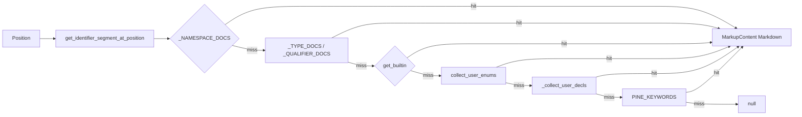

# Copyright (C) 2024-2026 jango_blockchained
#
# This file is part of pynescript.
#
# pynescript is free software: you can redistribute it and/or modify
# it under the terms of the GNU Affero General Public License as published by
# the Free Software Foundation, either version 3 of the License, or
# (at your option) any later version.
#
# pynescript is distributed in the hope that it will be useful,
# but WITHOUT ANY WARRANTY; without even the implied warranty of
# MERCHANTABILITY or FITNESS FOR A PARTICULAR PURPOSE.  See the
# GNU Affero General Public License for more details.
#
# You should have received a copy of the GNU Affero General Public License
# along with pynescript.  If not, see <https://www.gnu.org/licenses/>.
#
# SPDX-License-Identifier: AGPL-3.0-or-later

---
title: "Hover"
description: "textDocument/hover — Markdown cards for builtins, types, namespaces, keywords, and user declarations."
---

# Hover

## Abstract

Hover answers “what is this identifier?” in a fixed lookup order: **namespace** prefix, **type / qualifier**, **builtin** metadata, **user enums**, **user declarations** (functions, methods, types, enums, assigns), then **keywords**. The handler extracts the word under the cursor (including dotted forms) and returns a Markdown card. Builtin cards for dotted labels (`ta.sma`, `strategy.entry`, `line.fill`) append a Pine v6 function-reference markdown link. Keywords, types, namespaces, and user declarations stay link-free.

## Conceptual model



## Interface surface

- Method: `textDocument/hover`
- Capability: `hover_provider=True`
- Handler: `features/hover.py` → `handle_hover` (receives cached `tree=doc.ast` and optional per-version `feature_cache` for the user-decl walk)

### Lookup order

1. Identifier segment at cursor via `get_identifier_segment_at_position` (identifiers may include `.`).
2. Namespace: cursor on a module name (`ta` in `ta.sma`, or bare `ta` / `math`). Types that share a name (`line`, `array`, `color`) and callables (`strategy(`, `input(`) fall through.
3. Type or qualifier (`int`, `float`, `series`, `var`, …) when the segment is **not** followed by `(`.
4. Builtin lookup: full word, then leaf after `.`, then `module.word` if the preceding token ends with `.`.
5. Else user-enum type or `Enum.member` from the cached AST.
6. Else user declaration: `FunctionDef` / `TypeDef` / `EnumDef` / `Assign` (including tuple targets). First declaration of a name wins. Card fence is the source line snippet; brief is `User-defined {function|method|type|enum|variable}.`
7. Else keyword brief from `PINE_KEYWORDS`.
8. Build hover with range covering `[start, end)` of the word on the line.

### Builtin card structure

````markdown
```pinescript
{signature}
```

{brief}

**Parameters:** …   (when metadata includes params)

---
{first documentation paragraph, ≤500 chars}

**Example:** …
**See also:** `ta.ema`, …
[Pine v6: ta.sma](https://www.tradingview.com/pine-script-reference/v6/#fun_ta.sma)
````

Examples and related maps are **hardcoded** for a small high-value set (`ta.sma`, `ta.ema`, `ta.rsi`, `ta.macd`, strategy entry/exit, etc.). Others show signature + brief (and the docs link when the label is dotted).

`_build_docs_link` emits that markdown link only for dotted builtin labels with a namespace (`ta.sma`, `strategy.entry`, `line.fill`). Empty, undotted (`sma`), or whitespace-only names return `""`. Keyword, type, namespace, and user-declaration cards never include the TradingView URL.

## Internals

| Path | Role |
| --- | --- |
| `features/hover.py` | Word resolution + Markdown assembly |
| `providers/builtin_metadata.py` | `get_builtin` |
| `protocol/utils.py` | Identifier segment extraction |

The workspace `feature_cache` memos the user-declaration walk so each hover does not re-walk the whole AST.

## Invariants and edge cases

1. **No source → null.** Missing buffer aborts early.
2. **Line OOB → null.** Cursor past last line is ignored.
3. **Empty word → null.** Whitespace / punctuation yields no hover.
4. **User functions, assigns, types, and enums are hovered** — locals are not “null”. Use [definition](/pyne/docs/lsp/features/navigation) when you need a jump, not a card.
5. **Docs links are dotted builtins only.** Keywords, types, namespaces, and user decls stay link-free.
6. Documentation truncation is first-paragraph / 500-char only — full docs live in metadata and completion resolve.

## Worked example

Cursor on `sma` in `plot(ta.sma(close, 14))`:

- Word may be `ta.sma` if the dotted identifier is one match, or `sma` with module recovery from `ta.`.
- Response `contents.kind = markdown` with a fence of the metadata signature, plus `[Pine v6: ta.sma](https://www.tradingview.com/pine-script-reference/v6/#fun_ta.sma)`.

Cursor on `foo` in:

```pinescript
//@version=6
indicator("T")
foo(a) => a
plot(foo(1))
```

- Declaration and use both hover as a user-defined function with fence `foo(a) => a`.
- No Pine v6 URL.

## Failure modes

| Symptom | Cause |
| --- | --- |
| Hover never appears | Metadata empty or word not in catalog / AST |
| Wrong symbol | Identifier regex swallowed neighboring text — rare with `_.` pattern |
| Stale docs after adding builtin | Regenerate metadata — [builtin metadata](/pyne/docs/lsp/builtin-metadata) |
| User local shows no card | Parse failed (`tree=None`) so the decl walk is skipped |

## See also

- [Completion](/pyne/docs/lsp/features/completion)
- [Builtin metadata](/pyne/docs/lsp/builtin-metadata)
- [Navigation](/pyne/docs/lsp/features/navigation)
